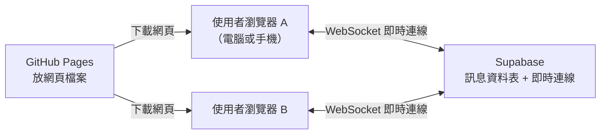

# 架構文件：匿名聊天室

> 這份文件用白話中文寫。專有名詞第一次出現時，會用一句話解釋。
> 需求來源：`docs/requirements.md`，以及 P4-1 問答整理出的共識（見第 7 節）。

## 1. 專案說明與目標

做一個**不用登入**的匿名聊天室：所有人在同一個聊天室，打開網頁、輸入代號就能聊天，電腦和手機都能用。

目標：
- 輸入代號後即可進入，看得到別人的訊息，也能送出訊息
- 看得到誰在線上，有人進出時有提示
- 先做出前端並放上 GitHub Pages，最後才接上 Supabase

## 2. 整體架構圖

- **GitHub Pages**：GitHub 提供的免費網頁空間，用來放我們做好的網頁檔案。
- **Supabase**：一個現成的線上後端服務，幫我們存訊息、轉送訊息給所有人。
- **WebSocket**：瀏覽器和伺服器之間保持不斷線的連線，有新訊息時伺服器能立刻推給你，不用你一直重新整理。



GitHub Pages 只負責「把網頁交給瀏覽器」；之後聊天的內容都在瀏覽器和 Supabase 之間走，不經過 GitHub。

## 3. 技術選擇

| 項目 | 選了什麼 | 為什麼 |
|---|---|---|
| 前端語言 | JavaScript（純 JavaScript，不使用 TypeScript） | 瀏覽器原生支援，資料最多，Claude Code 最熟 |
| 前端工具 | **Vite**（一個打包工具，把原始碼整理成能放上網頁的檔案）＋原生 JavaScript，不用大型框架 | 只有一個聊天室畫面，不需要框架；少了框架，部署和除錯都更簡單 |
| 即時訊息 | Supabase **Realtime** | 負責把新訊息立刻推給所有人 |
| 訊息保存 | Supabase **Postgres 資料表** `messages` | 需要「新人看得到最近 50 則」「保留最近 200 則」，必須存下來 |
| 線上名單 | Supabase Realtime 的 **Presence**（誰目前連著線的功能） | 它天生就是為「線上名單」設計的，斷線會自動消失 |
| 部署 | GitHub Pages ＋ GitHub Actions（自動化流程，推上去就自動發布） | 免費，且和 repo 在一起 |

## 4. 兩個階段

### 階段一：還沒接 Supabase

前端做完整，但「後端」先用**假的**代替（假後端把資料存在瀏覽器裡，用 BroadcastChannel 讓同一個瀏覽器的不同分頁彼此收得到）。

能做到：完整畫面、輸入代號、送訊息、線上名單、進出提示、手機版版面、深色模式。
做不到：不同電腦之間互通。別人用另一台電腦打開，看不到你的訊息。

放上 GitHub Pages 後，任何人都能打開網址看到畫面，自己開兩個分頁就能體驗聊天流程。

### 階段二：接上 Supabase

把假後端換成 Supabase 的真後端。這時不同人、不同裝置才真的連在一起。

### 怎麼避免整個重寫

畫面程式**只透過一組固定的介面**跟後端講話（`ChatService`），不直接碰 Supabase：

```
ChatService
  join(代號)       進入聊天室
  leave()          離開
  send(文字)       送出訊息
  onMessage(fn)    收到訊息時通知畫面
  onPresence(fn)   線上名單／進出變化時通知畫面
  onStatus(fn)     連線狀態（連線中／中斷／重連中）
  typing()         告訴其他人「我正在輸入」
  onTyping(fn)     別人正在輸入時通知畫面
```

階段一寫 `MockChatService`，階段二寫 `SupabaseChatService`，畫面只要換掉一行就能切換。

## 5. 通訊約定

畫面程式透過 `ChatService` 訂閱三種事件：

| 事件 | 意思 |
|---|---|
| `message` | 一則新的訊息，或一則加入／離開提示 |
| `presence` | 線上名單變了，每次給畫面**完整的名單**（畫面不需要自己分辨誰加入、誰離開） |
| `status` | 自己的連線狀態變化：`connected`（已連線）或 `disconnected`（中斷） |
| `typing` | 有人正在輸入（收到對方的代號）。透過 Supabase Broadcast 即時傳送，不存資料庫 |

另外有一個只在 Supabase 這一側使用的 Broadcast 事件 `bye`：正常離開（按「離開」或關掉網頁）時，離開的人先廣播一聲，其他人立刻顯示離開提示。

訊息資料格式（聊天訊息與提示共用，用 `type` 區分）：

```json
{
  "id": "訊息唯一編號",
  "type": "message",
  "nickname": "小明",
  "content": "大家好",
  "createdAt": "2026-10-13T14:32:00Z"
}
```

加入或離開提示的 `type` 是 `notice`，沒有 `nickname`，`content` 是「小明 加入了聊天室」這樣的文字。兩種都存在資料表 `messages`，所以新進者看得到歷史裡的提示。

線上名單格式：`[{ "nickname": "小明", "self": true }, ...]`，按加入順序排列，`self` 表示這是自己。（Supabase 的 Presence 內部還記錄加入時間，只用來排序與判斷誰先搶到代號，畫面用不到。）

## 6. 資料流

- **進入聊天室**：輸入代號 → 檢查規則與是否重複 → 通過後登記為在線 → 載入最近 50 則 → 顯示「某某加入了聊天室」。
- **送出訊息**：輸入文字（最多 500 字）→ 寫入 `messages` → Supabase 推給所有人 → 每個人的畫面新增這則訊息。超過 200 則時，最舊的會被刪掉。
- **離開**：按「離開」→ 馬上釋出代號（名單立刻更新），同時廣播 `bye`，還在線上的人**立刻**寫入「某某離開了聊天室」提示（同一則提示只會寫一次）。如果沒能廣播（例如直接斷網、當機），就改成等 30 秒確認對方沒有回來才寫。如果房間裡只剩離開的那個人，就不會有這則提示。
- **每 20 秒報到**：進入後，瀏覽器每 20 秒呼叫資料庫的 `heartbeat` 函式，告訴資料庫「還有人在線上」，供所有人離線後自動清空聊天室使用（見第 9 節）。
- **斷線重連**：頂端顯示「連線中斷，重新連線中…」，輸入框鎖住但保留已打的字；連回來後重新登記在線，並自動補上漏掉的訊息。沒廣播 `bye` 的離開（斷網）會等 30 秒才顯示提示，所以網路短暫中斷不會出現「離開」提示。重新整理頁面算正常離開，會看到「離開」和「加入」各一則。名單本身是即時更新的，中斷的人會暫時從名單消失。代號何時釋出，取決於 Supabase 偵測到斷線的時間，不是固定 30 秒。

## 7. 畫面清單

### 7-1 共識（P4-1 問答結果）

| 主題 | 決定 |
|---|---|
| 代號規則 | 1～12 字；中英文、數字、emoji 都可；前後空白自動去掉；全空白不能進；英文大小寫視為相同 |
| 代號重複 | 不允許，提示「這個代號已經有人用了，請換一個」；對方離線後可再使用 |
| 多分頁／多裝置 | 一律擋；有「離開」按鈕，按了馬上釋出；沒正常關閉時，等 Supabase 偵測到斷線後自動釋出（通常不到一分鐘，非固定值） |
| 重新整理 | 輸入框先填上次的代號，按確認才進入；若已被別人用，可改用別的 |
| 訊息內容 | 純文字、最多 500 字，網址不變連結，不做表情選單 |
| 送出方式 | 電腦：Enter 送出、Shift+Enter 換行；手機：Enter 換行、旁邊有送出按鈕 |
| 訊息顯示 | 代號＋內容＋時:分；同一人連續訊息合併只顯示一次代號；代號依名字固定配色；跨日加日期分隔線；自己靠右、別人靠左 |
| 歷史訊息 | 新人看到最近 50 則；資料庫只保留最近 200 則，畫面註明「訊息只保留最近的 200 則，所有人離開後會自動清空」 |
| 所有人離線後 | 自動清空所有訊息（階段二追加的需求，做法見第 9 節末段）。最後一個人離開後，約 2.5 到 3 分鐘內清空，不是立刻 |
| 線上名單 | 電腦：側邊欄常駐；手機：頂端「目前 N 人在線」，點了展開；自己標示「（你）」 |
| 進出提示 | 訊息之間插入灰色小字，留在歷史裡；正常離開立刻顯示，斷線的人等 30 秒確認沒回來才顯示 |
| 新增功能 | 手動切換主題、分頁標題未讀數、「正在輸入…」提示、資料庫發送頻率限制（細節見 `docs/requirements.md`「新增功能」） |
| 防洗版 | 第一版不做（已知風險） |
| 頻道 | 單一聊天室 |
| 風格 | 酒紅 `#9F0050` 為主色（標題列、送出按鈕、自己的訊息），淡黃 `#FFE66F` 點綴，底色白／淺灰 `#F5F5F5`，深色模式跟隨系統 |

### 7-2 畫面與元素

**畫面 A：輸入代號**
- 標題、代號輸入框（預填上次的代號）、「進入」按鈕
- 錯誤提示：空白、超過 12 字、代號已被使用
- 行為：按 Enter 或按鈕進入

**畫面 B：聊天室**
- 頂端列：聊天室名稱、「目前 N 人在線」（手機可點開名單）、主題切換按鈕、「離開」按鈕、連線狀態條
- 輸入框上方一行：「某某 正在輸入…」；送太快被擋時，同一行顯示「送太快了，請稍等幾秒再送」
- 線上名單：電腦在側邊欄；手機點開後展開；自己標「（你）」
- 訊息區：訊息、進出提示、日期分隔線、「只保留最近 200 則」說明；新訊息自動捲到底，若使用者正在看舊訊息則不強制捲動
- 輸入區：文字框（500 字上限，顯示剩餘字數）、送出按鈕；斷線時鎖住但保留文字

顏色與樣式交給 `/design`，這裡不規定。

## 8. 金鑰

| 金鑰 | 用途 | 能公開嗎 |
|---|---|---|
| Supabase 專案網址（Project URL） | 告訴前端連到哪個專案 | 可以 |
| `anon`（publishable）金鑰 | 前端用，權限由資料庫規則（RLS）限制。Supabase 新版稱為 Publishable key（`sb_publishable_` 開頭），用途相同；程式裡的變數名稱仍沿用 `VITE_SUPABASE_ANON_KEY` | **可以**放在前端，這是設計上的用法 |
| `service_role` 金鑰 | 擁有全部權限，繞過所有規則 | **絕對不能**出現在前端、repo、聊天或截圖 |

怎麼產生：在 Supabase 專案的 Settings → API 頁面可以看到，不需另外生成。

放哪裡：
- 本機：專案根目錄的 `.env.local`（寫 `VITE_SUPABASE_URL`、`VITE_SUPABASE_ANON_KEY`）
- GitHub：repo 的 Settings → Secrets and variables → Actions，部署時由 GitHub Actions 帶入
- `service_role` 只留在 Supabase 後台，這個專案**根本用不到**

不被 commit 的方式：`.gitignore` 加入 `.env`、`.env.local`、`.env.*.local`；Claude Code 在 `CLAUDE.md` 被告知不可 commit 金鑰檔案。注意：前端打包後 `anon` 金鑰一定會出現在網頁裡，所以安全靠的是資料庫規則，不是藏金鑰。

## 9. 安全與限制

別人可能送來的奇怪東西與對策：
- **含 HTML／script 的文字**：收到別人的訊息時，畫面先確認它是文字，再用 `textContent`（文字節點）放進畫面，**絕不使用 `innerHTML`**，所以訊息裡的 `<script>`、`<b>` 之類只會原樣顯示成文字，不會被執行。所有建立畫面元素的地方都集中在 `src/ui/dom.js` 的 `h()` 函式，它只接受文字節點
- **超長訊息**：前端限 500 字（用「字」計算，emoji 算一個字）；資料庫也設 CHECK 限制訊息內容 1～500 字，避免繞過前端。代號長度 12 字只在前端檢查，資料庫只擋 48 字以上的異常值
- **偽造代號／冒名／偽造提示**：因為不用登入、`anon` 金鑰又是公開的，任何人都能直接寫入資料庫，用別人的代號發訊息，或寫入假的「某某離開了聊天室」提示。匿名聊天室無法完全防止，列為已知限制
- **訊息不會長期保存**：資料庫最多只留最近 200 則，所有人離開後約 3 分鐘會全部清空。想留下對話內容的人要自己截圖或複製，系統不提供備份或匯出
- **洗版**：資料庫端限制同一個代號 10 秒內最多 6 則訊息（`supabase/rate-limit.sql`，用觸發器強制）。限制是依代號計算，而代號可以冒用（見上），所以這只能擋單純的狂刷，擋不了有心人換很多代號
- **直接呼叫資料庫**：因為 `anon` 金鑰公開，資料庫要開 RLS，只允許「讀訊息」與「依規則新增訊息」，不允許修改或刪除他人訊息
- **代號重複的競爭條件**：兩人同時搶同一個代號時，以先登記為準，後者重新選

**所有人離線後清空聊天室**（`supabase/clear-when-empty.sql`）：
- 每個在線的瀏覽器每 20 秒呼叫資料庫的 `heartbeat` 函式報到一次，記在 `online_sessions` 資料表
- 資料庫用排程（pg_cron）每 30 秒執行 `clear_chat_if_empty`：超過 150 秒沒人報到的紀錄會被移除；如果已經沒有任何人報到，就刪光所有訊息
- 為什麼是 150 秒：手機與背景分頁的計時器會被瀏覽器放慢，太短會誤判成有人離線
- 這張表和兩個函式都不開放前端直接修改資料；前端只能呼叫 `heartbeat`，不能呼叫清空函式，所以別人沒辦法從前端把聊天室清掉
- 已知限制：有人把瀏覽器丟在背景超過 150 秒、其他人又都離開時，聊天室可能被清空；這個人回來後畫面上還看得到舊訊息，重新整理才會同步

免費方案要注意的上限（**數字以 Supabase 當時官方說明為準，實作前需再確認**）：
- 同時連線數有上限
- 每秒訊息數有上限
- 專案閒置約一週可能被暫停，需要手動恢復
- 資料庫容量有限（只存 200 則，不會有問題）

## 10. 這一版刻意不做的事

| 不做 | 為什麼 |
|---|---|
| 註冊、登入 | 需求明說不要 |
| 管理者踢人／刪訊息 | 需要身分，跟「不登入」衝突 |
| 管理者層級的防洗版（封鎖、禁言） | 需要身分；只做資料庫端的發送頻率限制 |
| 圖片、檔案、表情選單 | 需求只要純文字 |
| 網址轉連結 | 避免釣魚連結與額外安全問題 |
| 多頻道 | 單一聊天室 |
| 永久保存歷史 | 只留最近 200 則，所有人離開後還會清空，簡單又省空間，也保護隱私 |

## 11. repo 資料夾結構

```
cocoanonymous-chat/
├─ CLAUDE.md
├─ README.md
├─ index.html
├─ package.json
├─ vite.config.js           # 設定 GitHub Pages 的網址路徑
├─ .gitignore
├─ .env.local               # 本機金鑰，不進 git
├─ .github/workflows/deploy.yml
├─ docs/
│  ├─ requirements.md
│  ├─ design.md             # 視覺設計
│  └─ architecture.md
├─ supabase/
│  ├─ schema.sql            # 資料表、RLS 規則、保留 200 則、開啟 Realtime
│  ├─ clear-when-empty.sql  # 報到函式、排程，所有人離線後清空聊天室
│  └─ rate-limit.sql        # 發送頻率限制（10 秒內最多 6 則）
└─ src/
   ├─ main.js               # 決定用哪個 ChatService（階段二：Supabase）
   ├─ nickname.js           # 代號與訊息長度規則
   ├─ ui/
   │  ├─ app.js             # 在兩個畫面之間切換
   │  ├─ login.js           # 畫面 A：輸入代號
   │  ├─ chat.js            # 畫面 B：聊天室
   │  ├─ theme.js           # 手動切換主題
   │  └─ dom.js             # 建立畫面元素的小工具
   ├─ service/
   │  ├─ ChatService.js     # 介面約定
   │  ├─ MockChatService.js # 階段一
   │  └─ SupabaseChatService.js  # 階段二
   └─ styles/
```

## 12. 部署到 GitHub Pages

1. repo 為公開（`https://github.com/yummycocoshawn/cocoanonymous-chat`）
2. 在 Settings → Pages 選擇用 **GitHub Actions** 部署
3. 推送到 `main` 後，Actions 自動執行打包並發布
4. 網址會是 `https://yummycocoshawn.github.io/cocoanonymous-chat/`；`vite.config.js` 的 `base` 要設成 `/cocoanonymous-chat/`，否則樣式與腳本會找不到
5. 階段二的金鑰透過 Actions 的 Secrets 帶入打包

## 13. 驗證清單

### 階段一（假後端）
- [ ] 網址在 GitHub Pages 上能打開，樣式正常
- [ ] 輸入代號進入；空白、超過 12 字會被擋
- [ ] 同一瀏覽器兩個分頁用相同代號，第二個被擋
- [ ] 一個分頁送訊息，另一個分頁立刻看到
- [ ] 線上名單與進出提示正確；「離開」後代號釋出
- [ ] 重新整理後輸入框預填上次代號
- [ ] 手機寬度版面正常：名單收合、Enter 換行、有送出按鈕
- [ ] 貼入 `<script>` 文字只會當純文字顯示
- [ ] 深色模式跟隨系統

### 階段二（接上 Supabase）
- [ ] 兩台不同裝置能互相收到訊息
- [ ] 新進入者看到最近 50 則；超過 200 則時舊的被刪
- [ ] 不同裝置用相同代號會被擋；按「離開」後代號馬上釋出；直接關掉網頁後，等 Supabase 偵測到斷線代號就會釋出
- [ ] 斷網後出現「重新連線中」，輸入的字保留，連回後補上漏掉的訊息
- [ ] 網路短暫中斷、重新連線（30 秒內），其他人看不到「離開了聊天室」提示；超過 30 秒沒回來才會出現
- [ ] 輸入 500 個字（含 emoji）都能正常送出，超過的部分輸入不進去
- [ ] 一個人打字時，另一個人在輸入框上方看到「某某 正在輸入…」，對方送出後消失
- [ ] 按「離開」後，其他人馬上看到離開提示
- [ ] 一個代號 10 秒內連續送 7 則，第 7 則被擋，畫面顯示「送太快了」
- [ ] 主題按鈕可在跟隨系統、淺色、深色之間切換，重新整理後保留
- [ ] 分頁在背景時收到訊息，分頁標題出現未讀數，回到分頁後消失
- [ ] 所有人離開後約 3 分鐘，再進入聊天室時看不到舊訊息
- [ ] 還有人在線時，聊天室不會被清空
- [ ] 直接用 `anon` 金鑰嘗試修改或刪除訊息會失敗，也不能呼叫 `clear_chat_if_empty`
- [ ] repo 與打包後的網頁中找不到 `service_role` 金鑰
- [ ] 部署版與本機版行為一致
